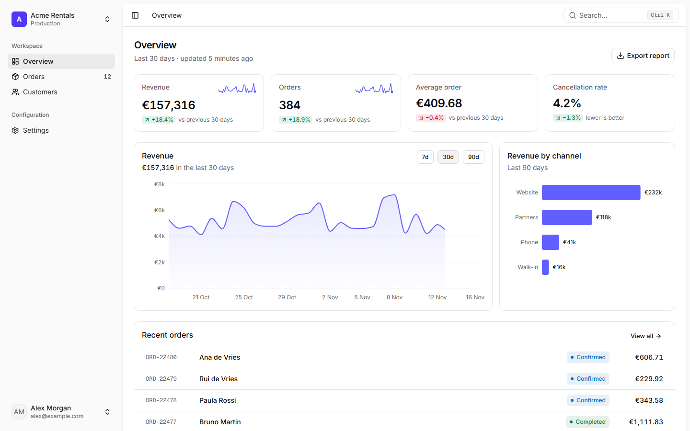

# backoffice-kit

Padrão visual de back office do Marcio para **todos** os admins e dashboards: Next.js + Tailwind v4 + shadcn/ui (estilo **Nova**, base Radix). Este repositório é ao mesmo tempo:

1. **o protótipo de referência**: uma app Next.js com shell, dashboard, tabela, formulário e estado vazio, com dados de exemplo;
2. **um registry shadcn próprio** (`registry.json` → `public/r/*.json`), de onde qualquer projeto instala o tema e os blocos com `shadcn add`.

Origem: [Marcio-RF/algarve4all.com#31](https://github.com/Marcio-RF/algarve4all.com/issues/31).

| Claro | Escuro |
|---|---|
|  |  |
|  |  |
|  |  |

## Decisões

| Tema | Decisão |
|---|---|
| Fonte | **Inter** (variável, via `next/font`) para a interface; **Geist Mono** para IDs e códigos. Números tabulares (`tabular-nums`) em `td`, `th`, KPIs e valores. |
| Paleta | Neutros **zinc** + **um** acento (índigo por padrão). Cada projeto troca só `--primary`, `--ring`, `--sidebar-primary`, `--sidebar-ring` e `--chart-1/2`. Vermelho, âmbar, verde e azul ficam reservados a estados (`--destructive`, `--warning`, `--success`, `--info`). |
| Modo | Claro e escuro seguem o sistema (`defaultTheme="system"`); seletor claro/escuro/sistema no menu do utilizador e no ⌘K. O escuro tem passos próprios, não é uma inversão do claro. |
| Densidade | Estilo Nova (compacto). Corpo de texto de 14px, controlos de 32px, linhas de tabela de 40px, com opção "compacta" de 32px por tabela. |
| Raios | `--radius: 0.5rem` (8px). Cartões a ~11px (`rounded-xl`), badges a 6px. Pílulas só em avatares e switches. |
| Navegação | Sidebar *inset* à esquerda que recolhe para ícones (`Ctrl/⌘+B`), seletor de workspace/ambiente no topo e utilizador no rodapé. Cabeçalho com breadcrumbs e command menu (`Ctrl/⌘+K`). Sem topbar de navegação. |
| Gráficos | shadcn charts (Recharts). Uma série = uma cor (o acento), sem legenda; tooltip com crosshair; rótulos diretos nas barras; nada de donuts ou bolhas decorativos. |
| Acessibilidade | WCAG 2.1 AA: todos os pares texto/fundo do tema ≥ 4,5:1 nos dois modos (verificado por script); skip link; `aria-current` na navegação; `aria-sort` nas colunas; estados nunca só por cor (ponto + texto, seta + sinal). |
| Idioma | A interface dos admins é em inglês. |

## Usar noutro projeto

O projeto precisa de Next.js com App Router, Tailwind v4 e shadcn inicializado (`pnpm dlx shadcn@latest init -b radix --preset nova`).

1. Registe o registry no `components.json` do projeto:

   ```json
   "registries": {
     "@backoffice": "https://raw.githubusercontent.com/Marcio-RF/backoffice-kit/main/public/r/{name}.json"
   }
   ```

   O registry é servido direto do branch `main`: o que for commitado em `public/r/` fica disponível. Para fixar uma versão, troque `main` por uma tag ou commit. Para testar mudanças antes do push, corra `pnpm dev` neste repositório e use `http://localhost:3000/r/{name}.json`.

2. Instale o que precisar:

   ```bash
   pnpm dlx shadcn@latest add @backoffice/theme        # só o tema
   pnpm dlx shadcn@latest add @backoffice/shell        # shell completo (inclui o tema e substitui app/layout.tsx)
   pnpm dlx shadcn@latest add @backoffice/data-table   # tabela com filtros
   pnpm dlx shadcn@latest add @backoffice/form-layout  # secções de formulário + barra de ações
   pnpm dlx shadcn@latest add @backoffice/dashboard    # KPI, sparkline, estado vazio
   pnpm dlx shadcn@latest add @backoffice/examples     # as páginas de exemplo deste protótipo
   ```

3. Troque o acento no `globals.css` do projeto (só os tokens listados em **Paleta**) e confira o contraste com `scripts/check-contrast.py` (ver **Desenvolvimento**).

Os ficheiros instalados passam a ser do projeto. Para receber uma versão nova do padrão, volte a correr `shadcn add` e reveja o diff.

## Desenvolvimento

```bash
pnpm install
pnpm dev                 # protótipo em http://localhost:3000
pnpm exec shadcn build   # regenera public/r/*.json a partir de registry.json
pnpm build
python scripts/check-contrast.py src/app/globals.css   # contraste AA dos tokens, claro e escuro
```

Ao alterar um bloco, edite o código em `src/`, confira se o item correspondente em `registry.json` lista todos os ficheiros e corra `shadcn build`.

### Estrutura

```
src/app/layout.tsx            fontes, ThemeProvider, Toaster      → @backoffice/shell
src/app/(app)/layout.tsx      SidebarProvider + sidebar + header  → @backoffice/shell
src/components/shell/         sidebar, header, ⌘K, page header    → @backoffice/shell
src/components/data-table/    DataTable, filtros, skeleton        → @backoffice/data-table
src/components/forms/         FormSection, FormActions            → @backoffice/form-layout
src/components/dashboard/     KpiCard, Sparkline, gráficos        → @backoffice/dashboard / examples
src/app/(app)/**/page.tsx     páginas de exemplo                  → @backoffice/examples
```

## Regras para quem constrói telas com este padrão

- Um acento só. Cor serve para significado (ação principal, estado, foco), nunca para decorar.
- Todo o estado leva texto ou ícone além da cor (`StatusBadge`, delta dos KPIs).
- Valores numéricos alinham à direita e usam `tabular-nums`; IDs usam `font-mono`.
- Uma página = `PageContainer` + `PageHeader` (título, descrição curta, ações à direita).
- Tabelas: pesquisa + filtros em chips por cima, detalhe num `Sheet` lateral, ações da linha no menu `⋯`.
- Formulários: secções `FormSection`, erros específicos ("Enter a valid email address, like name@example.com"), foco no primeiro campo inválido, ações numa barra fixa em baixo.
- Gráficos: um eixo y, sem legendas para uma série só, tooltip sempre.
