# backoffice-kit

Padrão visual de back office do Marcio para **todos** os admins e dashboards: Next.js + Tailwind v4 + shadcn/ui (estilo **Nova**, base Radix). Este repositório é ao mesmo tempo:

1. **o protótipo de referência**: uma app Next.js com shell, dashboard, tabela, formulário e estado vazio, com dados de exemplo;
2. **um registry shadcn próprio** (`registry.json` → `public/r/*.json`), de onde qualquer projeto instala o tema e os blocos com `shadcn add`.

Origem: [Marcio-RF/algarve4all.com#31](https://github.com/Marcio-RF/algarve4all.com/issues/31).

| Claro | Escuro |
|---|---|
|  | 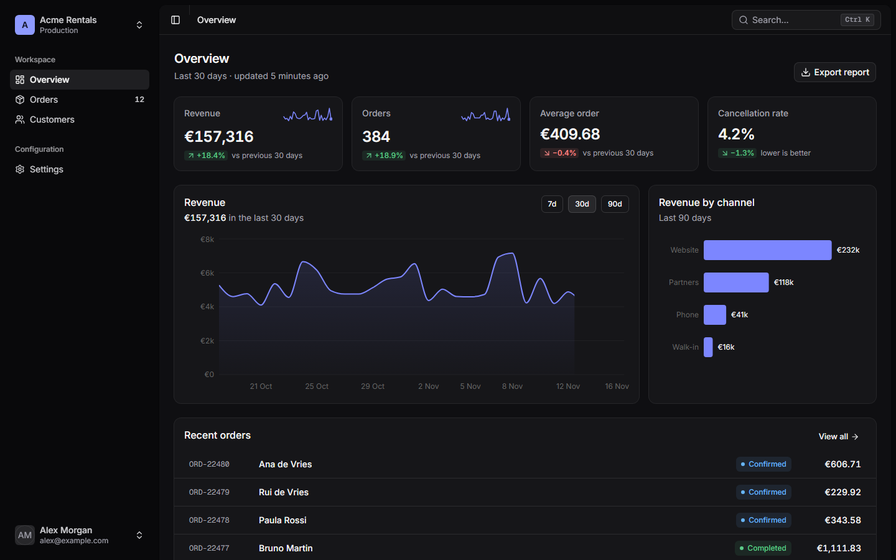 |
| 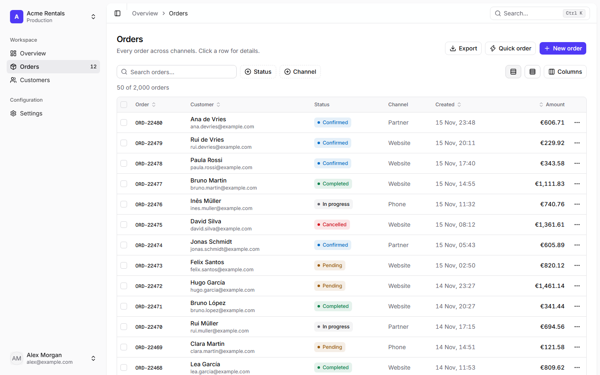 | 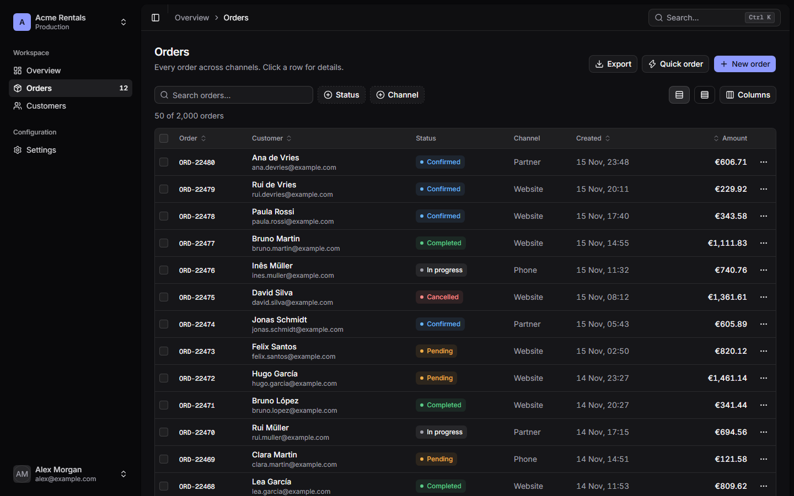 |
| 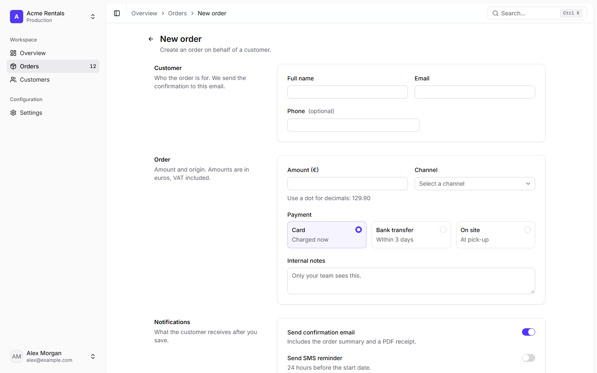 | 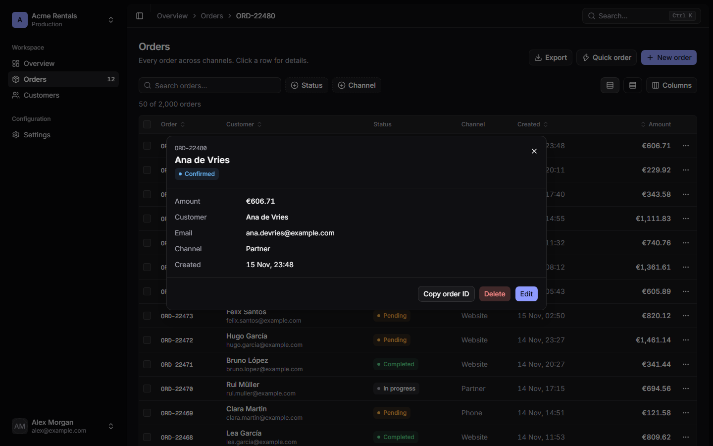 |
| 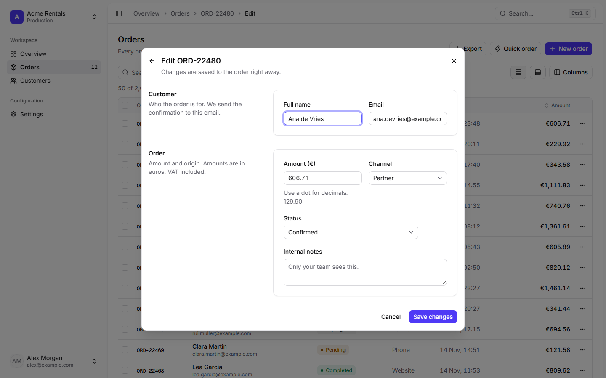 | |

## No celular

Abaixo de 768px (o **Celular**) o kit muda de forma: a tabela vira uma **Lista de cartões**, os Filtros (facetas e ordenação) vão para um painel de baixo, o **Dialog roteado** (Detalhe, criar, editar) ocupa a tela inteira e parece uma página, os **alvos de toque** passam a 44px e os campos a 16px (sem zoom no iOS). Tudo verificado a 375×812 pelo `pnpm check:mobile`, que também tira as capturas abaixo.

| | Claro | Escuro |
|---|---|---|
| Overview | 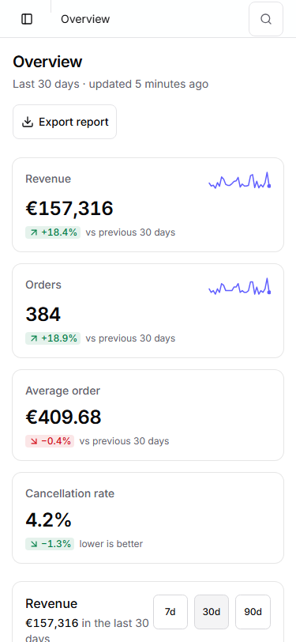 | 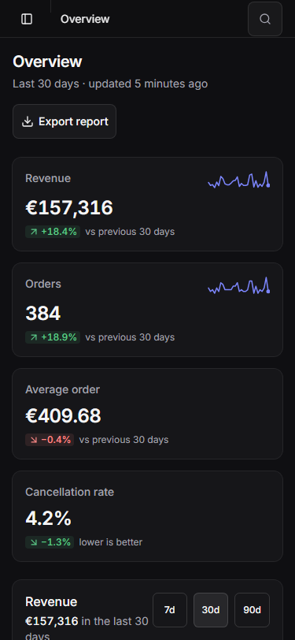 |
| Orders (Lista de cartões) | 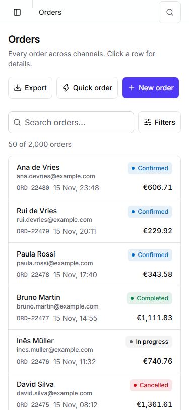 | 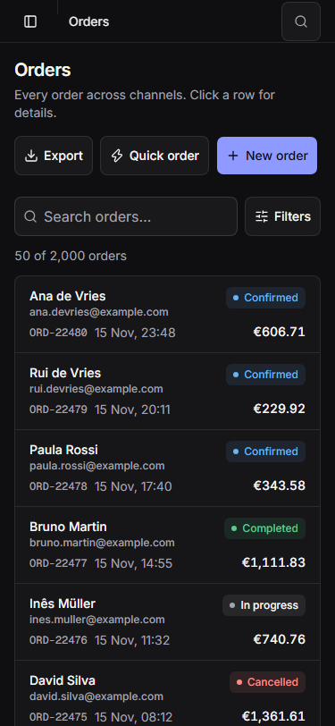 |
| Painel de Filtros | 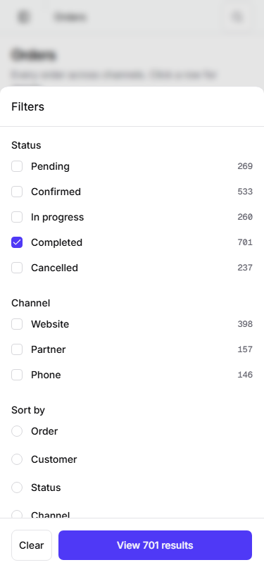 | 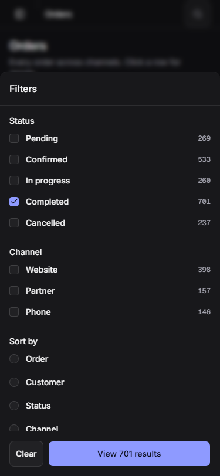 |
| Detalhe (Dialog roteado) | 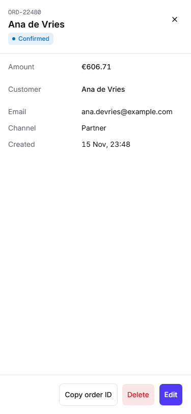 | 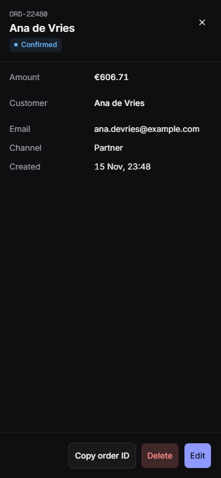 |
| Editar (Dialog roteado) | 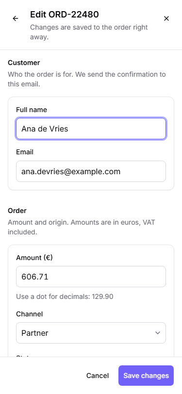 | 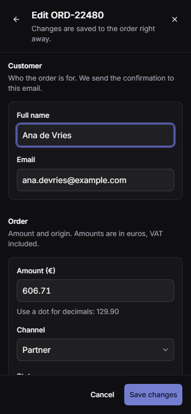 |
| New order | 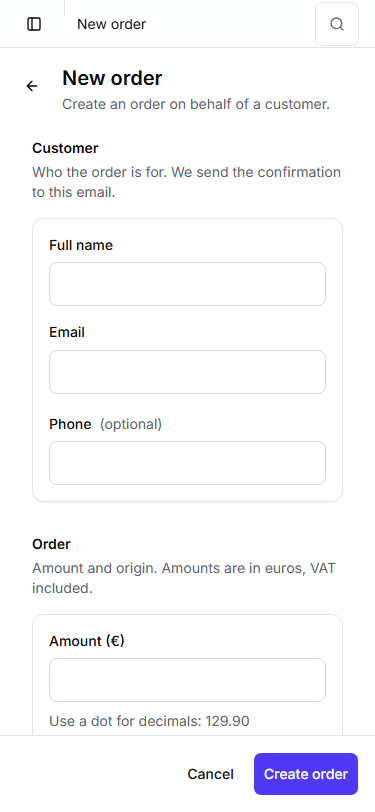 | 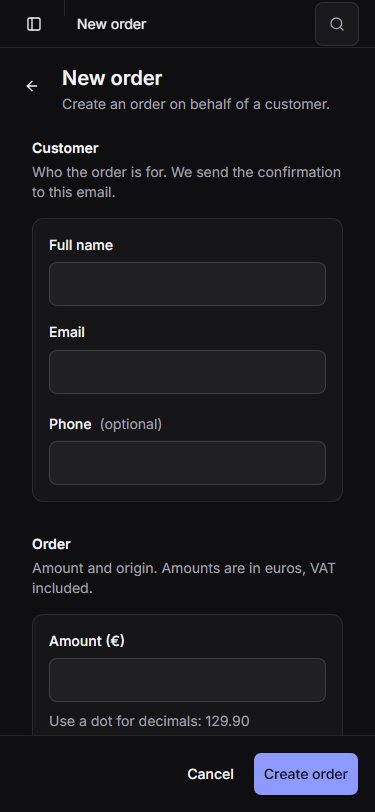 |
| Quick order (Fluxo móvel) | 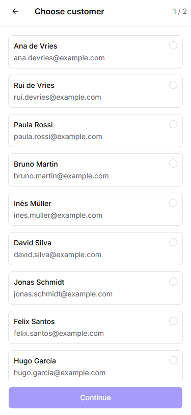 | 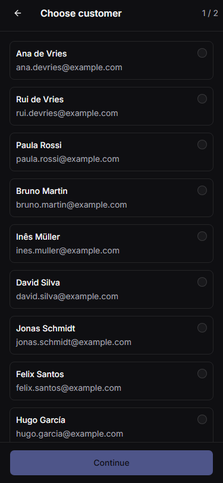 |

### Blocos

- **`DataTable` + `DataTableToolbar`** (`@backoffice/data-table`): scroll infinito com cursor e linhas virtualizadas, no celular e no desktop (ver **Listagens e Dialog roteado**). No celular a tabela é uma Lista de cartões. Cada coluna escolhe o seu lugar no cartão com `meta.mobile` (`"title"`, `"subtitle"`, `"status"` ou `"value"`); as colunas sem slot não aparecem. A `DataTableToolbar` mantém a pesquisa sempre visível e leva os filtros por faceta (`filters`) e o *Sort by* (`sortColumns`) para o painel **Filters**, que aplica as escolhas na hora e mostra "View N results". A partir de 768px volta aos chips, à densidade e às colunas.
- **`RoutedDialog`** (`@backoffice/routed-dialog`): o Dialog roteado, a moldura com URL própria onde abrem o Detalhe, criar, editar e as ações de uma listagem, sem a desmontar. Faz zoom a partir da linha ou do cartão e encolhe de volta ao fechar; fecha com ×, Esc, voltar do navegador ou do Android, clique fora e arrastar para baixo. Tela cheia no celular, painel centrado a partir de 768px. A mesma URL acedida diretamente (ou com F5) abre a página inteira (`RoutedPage`) com o mesmo conteúdo.
- **`MobileFlow`** (`@backoffice/mobile-flow`): o Fluxo móvel, um layout de tela cheia (`dvh`) sem sidebar para tarefas feitas no celular. Compõe-se com `MobileFlowHeader` (voltar, título do passo, slot à direita), `MobileFlowContent` (rola) e `MobileFlowActions` (barra de ação fixa em baixo, com a área segura). É só layout: o estado dos passos é da página. O exemplo está em *Quick order* (`@backoffice/examples`), que também abre num Dialog roteado (`chrome="none"`).

## Listagens e Dialog roteado

Nada aberto a partir de uma listagem a desmonta (ADR 0002, que vem do ADR-0009 do Donna ERP).

**Scroll infinito.** A `DataTable` recebe `fetchPage({ cursor, query }) → { items, nextCursor, total, facets? }`. A pesquisa, os filtros e a ordenação correm no servidor. As listas pequenas continuam a poder passar `data`. As linhas são virtualizadas: só as visíveis existem na página. A próxima página é pedida quando falta uma tela para o fim, e o total fica no topo ("50 of 2,000 orders"). A pesquisa, os filtros e a ordenação vivem na URL (`q`, um parâmetro por coluna, `sort=coluna.asc|desc`), e mudar qualquer um deles volta ao topo.

**Só o item alterado muda.** Com `resource` e `fetchItem(id, query) → { item, matches } | null`, a lista atualiza um registo no lugar depois de `markItemChanged(resource, id)` ou `markItemCreated(resource, id)`, ao fechar o dialog e sem mexer no scroll:
- o registo que deixou de bater com os filtros fica marcado ("Doesn't match filters");
- o excluído fica riscado ("Deleted");
- o criado entra no topo ("New").

As marcas somem na próxima pesquisa.

**Restauração.** Ao sair pela sidebar e voltar, a lista volta com as mesmas páginas, marcas e scroll, a partir de um cache em memória que guarda só as últimas 5 listas, por até 10 minutos e com até 1.000 registos cada. O F5 mantém só os filtros.

```tsx
<DataTable
  label="Orders"
  columns={columns}
  fetchPage={fetchOrdersPage}     // server action ou fetch, por cursor
  resource="orders"
  fetchItem={fetchOrder}
  getRowHref={(o) => `/orders/${o.id}`}  // o cartão vira link e a linha é clicável
/>
```

**Estrutura das rotas.** Há um único slot `@modal` no layout da app, com um interceptador por rota de registo. O `@backoffice/routed-dialog` instala a base, e cada projeto acrescenta os interceptadores:

```
app/(app)/layout.tsx                      renderiza {modal} (já vem no @backoffice/shell)
app/(app)/@modal/layout.tsx               <RoutedDialogHost>: a moldura, parada entre conteúdos
app/(app)/@modal/default.tsx              null: sem rota interceptada, sem dialog
app/(app)/@modal/page.tsx                 null: ir para "/" fecha o dialog
app/(app)/@modal/[...catchAll]/page.tsx   null: a sidebar e outros links fecham o dialog
app/(app)/@modal/(.)orders/[id]/page.tsx  <RoutedDialog><OrderDetail /></RoutedDialog>
app/(app)/orders/[id]/page.tsx            <RoutedPage backHref="/orders"><OrderDetail /></RoutedPage>
```

O conteúdo usa `RoutedDialogHeader`, `RoutedDialogTitle`, `RoutedDialogDescription`, `RoutedDialogBody` e `RoutedDialogFooter`, que se adaptam ao dialog ou à página. Navegar dentro (Pedido → Cliente) troca só o conteúdo: o ← volta um passo, e o × volta à lista. Num formulário, o foco vai para o primeiro campo, e `useRoutedDialogDirty(isDirty)` pergunta "Discard changes?" antes de fechar ou voltar. `useRoutedDialog()` dá `back` e `close` (com `{ force, refresh }`) a quem desenha a própria barra, como o Fluxo móvel.

**O que mudou na v0.3.0 (breaking):**
- sai o `DetailSheet`, substituído pelo Dialog roteado;
- sai a paginação numerada (`pageSize`, os botões Anterior/Seguinte e os Rótulos `previousPage`, `nextPage` e `range`);
- os Rótulos `range` e `selected(selected, total)` dão lugar a `total(loaded, total)` e `selected(n)`.

## Rótulos

Todo texto visível de um bloco vem de um objeto de **Rótulos** com valores padrão em inglês. Cada bloco aceita uma prop `labels` com substituições parciais, que se fundem com o padrão; o que não for passado fica como está:

```tsx
<DataTableToolbar
  table={table}
  density={density}
  onDensityChange={setDensity}
  search={{ label: "Pesquisar encomendas" }}
  labels={{ filters: "Filtros", clear: "Limpar", showResults: (n) => `Ver ${n} resultados` }}
/>
```

Os tipos e os padrões são exportados junto de cada bloco (`DataTableLabels` / `defaultDataTableLabels`, `DataTableToolbarLabels`, `RoutedDialogLabels`, `MobileFlowLabels`, …). Os Rótulos com números são funções, como ``total: (loaded, total) => `${loaded} de ${total} pedidos` ``. A página `/fixtures` mostra os blocos em português.

## Decisões

| Tema | Decisão |
|---|---|
| Fonte | **Inter** (variável, via `next/font`) para a interface; **Geist Mono** para IDs e códigos. Números tabulares (`tabular-nums`) em `td`, `th`, KPIs e valores. |
| Paleta | Neutros **zinc** + **um** acento (índigo por padrão). Cada projeto troca só `--primary`, `--ring`, `--sidebar-primary`, `--sidebar-ring` e `--chart-1/2`. Vermelho, âmbar, verde e azul ficam reservados a estados (`--destructive`, `--warning`, `--success`, `--info`). |
| Modo | Claro e escuro seguem o sistema (`defaultTheme="system"`); seletor claro/escuro/sistema no menu do utilizador e no ⌘K. O escuro tem passos próprios, não é uma inversão do claro. |
| Densidade | Estilo Nova (compacto). Corpo de texto de 14px, controlos de 32px, linhas de tabela de 40px, com opção "compacta" de 32px por tabela. |
| Raios | `--radius: 0.5rem` (8px). Cartões a ~11px (`rounded-xl`), badges a 6px. Pílulas só em avatares e switches. |
| Navegação | Sidebar *inset* à esquerda que recolhe para ícones (`Ctrl/⌘+B`), seletor de workspace/ambiente no topo e utilizador no rodapé. Cabeçalho com breadcrumbs e command menu (`Ctrl/⌘+K`). Sem topbar de navegação. |
| Gráficos | shadcn charts (Recharts). Uma série = uma cor (o acento), sem legenda; tooltip com crosshair; rótulos diretos nas barras; nada de donuts ou bolhas decorativos. |
| Acessibilidade | WCAG 2.1 AA: todos os pares texto/fundo do tema ≥ 4,5:1 nos dois modos (verificado por script); skip link; `aria-current` na navegação; `aria-sort` nas colunas; estados nunca só por cor (ponto + texto, seta + sinal). |
| Listagens | Scroll infinito por cursor, nunca paginação numerada; linhas virtualizadas; pesquisa, filtros e ordenação na URL; cache em memória das últimas 5 listas (ADR 0002). |
| Detalhe | Num **Dialog roteado** (Parallel + Intercepting Routes), nunca num `Sheet` nem numa página que desmonte a lista; a mesma URL é uma página inteira. O zoom usa View Transitions; sem suporte do navegador ou com `prefers-reduced-motion`, não há animação. |
| Idioma | O idioma da interface é definido por projeto. Os blocos trazem os **Rótulos** (todos os textos visíveis) em inglês por padrão; cada projeto troca os que precisar (ver **Rótulos**). |

## Usar noutro projeto

O projeto precisa de Next.js com App Router, Tailwind v4 e shadcn inicializado (`pnpm dlx shadcn@latest init -b radix --preset nova`).

1. Registe o registry no `components.json` do projeto:

   ```json
   "registries": {
     "@backoffice": "https://raw.githubusercontent.com/Marcio-RF/backoffice-kit/v0.3.0/public/r/{name}.json"
   }
   ```

   O URL com a tag (`v0.3.0`) fixa a versão: o que instalar hoje é o que instalará amanhã. Quem quiser sempre a última versão troca `v0.3.0` por `main`, que serve direto o que for commitado em `public/r/`. Para testar mudanças antes do push, corra `pnpm dev` neste repositório e use `http://localhost:3000/r/{name}.json`.

2. Instale o que precisar:

   ```bash
   pnpm dlx shadcn@latest add @backoffice/theme        # só o tema
   pnpm dlx shadcn@latest add @backoffice/shell        # shell completo (inclui o tema e substitui app/layout.tsx)
   pnpm dlx shadcn@latest add @backoffice/data-table   # tabela com scroll infinito, filtros, Lista de cartões e DataTableToolbar
   pnpm dlx shadcn@latest add @backoffice/routed-dialog # Dialog roteado e a base do slot @modal
   pnpm dlx shadcn@latest add @backoffice/form-layout  # secções de formulário + barra de ações
   pnpm dlx shadcn@latest add @backoffice/dashboard    # KPI, sparkline, estado vazio
   pnpm dlx shadcn@latest add @backoffice/mobile-flow  # Fluxo móvel: tela cheia sem sidebar, para tarefas no celular
   pnpm dlx shadcn@latest add @backoffice/examples     # as páginas de exemplo deste protótipo
   ```

3. Troque o acento no `globals.css` do projeto (só os tokens listados em **Paleta**) e confira o contraste com `scripts/check-contrast.py` (ver **Desenvolvimento**).

Os ficheiros instalados passam a ser do projeto. Para receber uma versão nova do padrão, volte a correr `shadcn add` e reveja o diff.

## Desenvolvimento

```bash
pnpm install
pnpm dev                 # protótipo em http://localhost:3000
pnpm exec shadcn build   # regenera public/r/*.json a partir de registry.json
pnpm build
pnpm exec playwright install chromium   # uma vez, para o check:mobile
pnpm check:mobile        # build + start + Playwright a 375px; também refaz as 21 capturas em docs/screenshots
python scripts/check-contrast.py src/app/globals.css   # contraste AA dos tokens, claro e escuro
```

Ao alterar um bloco, edite o código em `src/`, confira se o item correspondente em `registry.json` lista todos os ficheiros e corra `shadcn build`.

### Estrutura

```
src/app/layout.tsx            fontes, ThemeProvider, Toaster      → @backoffice/shell
src/app/(app)/layout.tsx      SidebarProvider + sidebar + header  → @backoffice/shell
src/components/shell/         sidebar, header, ⌘K, page header    → @backoffice/shell
src/components/data-table/    DataTable, toolbar, filtros, cache    → @backoffice/data-table
src/components/routed-dialog/ RoutedDialog, RoutedPage            → @backoffice/routed-dialog
src/app/(app)/@modal/         slot do Dialog roteado              → @backoffice/routed-dialog (base) / examples
src/components/mobile-flow/   MobileFlow (Fluxo móvel)            → @backoffice/mobile-flow
src/components/forms/         FormSection, FormActions            → @backoffice/form-layout
src/components/dashboard/     KpiCard, Sparkline, gráficos        → @backoffice/dashboard / examples
src/app/(app)/**/page.tsx     páginas de exemplo                  → @backoffice/examples
```

## Regras para quem constrói telas com este padrão

- Um acento só. Cor serve para significado (ação principal, estado, foco), nunca para decorar.
- Todo o estado leva texto ou ícone além da cor (`StatusBadge`, delta dos KPIs).
- Valores numéricos alinham à direita e usam `tabular-nums`; IDs usam `font-mono`.
- Uma página = `PageContainer` + `PageHeader` (título, descrição curta, ações à direita).
- Tabelas: pesquisa + filtros em chips por cima (num painel de baixo no celular), scroll infinito, ações da linha no menu `⋯`. Tudo o que abre a partir da lista (Detalhe, criar, editar, ações) é um Dialog roteado.
- Formulários: secções `FormSection`, erros específicos ("Enter a valid email address, like name@example.com"), foco no primeiro campo inválido, ações numa barra fixa em baixo.
- Gráficos: um eixo y, sem legendas para uma série só, tooltip sempre.
